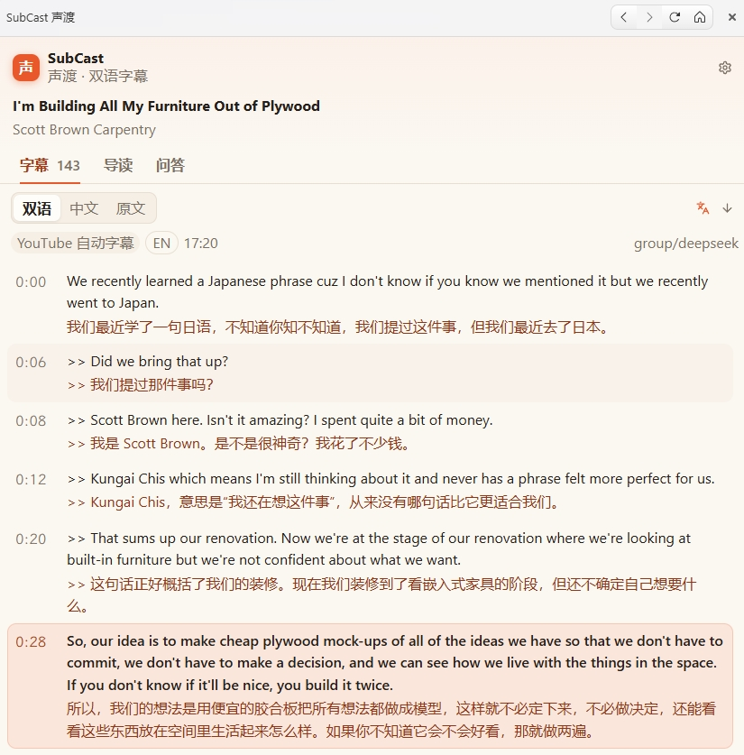

# SubCast · 声渡 — Chrome 插件版

把 YouTube / YouTube Music 视频和播客单集（小宇宙、Apple Podcasts、喜马拉雅）变成「双语字幕 + AI 导读 + 带时间戳的问答」的 Chrome Manifest V3 插件。



## 这个项目从哪来

[SubCast（声渡）](https://github.com/joeseesun/subcast) 原本是一个 macOS / Windows / Linux 桌面 App：订阅海外播客和 YouTube，拉取或本机识别音频，生成双语字幕、AI 导读和问答。它用 Tauri + Rust 写成，识别和下载都在本机完成，能力完整，但需要安装 App，也只能在 App 里看。

这个仓库是它的 **Chrome 浏览器实现**：不安装桌面程序，打开 YouTube 视频或播客单集网页就能在侧边栏看到同一套双语字幕、导读和问答。代码按浏览器扩展的边界重写，不是把桌面版打包进浏览器：

- 内容脚本只在 YouTube / YouTube Music、小宇宙、Apple Podcasts、喜马拉雅和 Spotify 的单集页运行，**不发任何跨域请求**；B 站等其他站点暂不支持，B 站视频页会提示一次；
- 所有网络请求由 background service worker 统一发起；
- 翻译、云端识别这类长任务放进 offscreen document，避免 MV3 worker 被回收；
- 字幕、译文、导读、问答存在 IndexedDB，设置和 Key 存在 `chrome.storage.local`；
- 复用桌面版的数据模型（`segments [{start,end,text}]`、译文与字幕 1:1 对齐）和共享字幕服务。

它是桌面版的补充，不是替代品。桌面版有本地识别、订阅、下载、离线播放；浏览器版没有，也不打算通过 yt-dlp 或本地进程补上。

## 能做什么

- **双语字幕**：有官方字幕用官方，有 YouTube 自动字幕就用自动字幕；侧边栏逐句列出，当前句高亮，点时间戳跳到对应位置。支持双语 / 中文 / 原文三种显示。
- **自动字幕语言不对时改用识别**：中文视频如果只有英文自动字幕，不会把对不上的英文显示出来；已配置云端识别时直接用音频生成字幕，没配置时提示配置。
- **视频页浮层**：在播放器右下角渲染一层双语字幕，可在侧边栏开关。
- **播客单集（小宇宙 / Apple Podcasts / 喜马拉雅）**：单集页没有字幕轨，直接用你自己的 Groq / OpenAI Key 生成字幕，识别完自动翻译、补标点，并能生成导读和问答；点字幕跳到页面自带的播放器，站内换集会自动切到新单集。Apple 的音频和时长来自节目公开的 iTunes 目录，喜马拉雅来自专辑公开 RSS，小宇宙直接读单集页数据。
- **其他平台的边界**：YouTube Music 复用 YouTube 的字幕链路；Spotify 单集页会说明音频有 DRM、扩展无法下载；B 站等站点暂不支持。
- **整集翻译**：Google 免费翻译优先，中国大陆网络自动走 `elon.qiaomu.ai` 中转；也可以配置任意 OpenAI 兼容模型（预置 DeepSeek）。译文按批保存，关掉再打开会续译，不会从头再来。
- **中文标点**：YouTube 中文字幕、中文译文或中文播客识别结果缺少标点时，用已配置的模型自动补全；只添加标点、不改字。没配模型时自动跳过。
- **AI 导读**：一句话总结、时间线、核心观点、值得回听的片段，全部带可点击时间戳；生成后缓存，优先使用共享导读。
- **AI 问答**：基于整份带时间戳的字幕回答，引用 `[mm:ss]` 可点击跳转；对话按单集保存。
- **共享字幕**：别人识别过的视频，打开就能用；只有云端识别的结果会在你同意后上传，且**只上传文字，不上传音频**。
- **云端识别**：没有字幕的视频，或没有字幕轨的播客单集，可以用你自己的 Groq / OpenAI Key 做识别；默认关闭。除「自动字幕和语音语言不一致时自动改用识别」这一种情况外，每次都要二次确认。

## 安装

### 从 GitHub Release 安装（推荐）

每次发布都会生成一个可直接加载的 zip：

<https://github.com/midpoint/subcast_extension/releases/latest/download/subcast-extension-chrome.zip>

1. 下载并解压到一个固定目录（不要放在「下载」里临时目录，Chrome 会记住这个路径）。
2. 打开 `chrome://extensions`，开启右上角「开发者模式」。
3. 点「加载已解压的扩展程序」，选择解压后的目录。
4. 打开任意 YouTube 视频、YouTube Music 或播客单集页，点地址栏右侧的 SubCast 图标打开侧边栏。

> 插件尚未上架 Chrome Web Store，所以以「已解压扩展」的方式加载。Chrome 启动时可能提示关闭开发者模式扩展，选择保留即可。

### 从源码构建

要求 Node.js 20+、Chrome / Chromium 116+。

```bash
git clone https://github.com/midpoint/subcast_extension.git
cd subcast_extension
npm ci
npm run build
```

然后在 `chrome://extensions` 里加载 `.output/chrome-mv3`。

> 侧边栏必须从工具栏图标打开；扩展页里直接访问 `chrome-extension://<id>/sidepanel.html` 只是调试入口。

## 使用

1. **打开一个 YouTube 视频、YouTube Music 或播客单集页**。插件会自动识别这一期；YouTube 有字幕就直接开始翻译，没有字幕或播客单集会提示可以用云端识别。
2. **看字幕**。侧边栏的「字幕」页会逐句显示原文和中文，当前播放句高亮；点任意一句的时间跳到那里。顶部可以切换双语 / 中文 / 原文。
3. **生成导读**。切到「导读」页，点「生成导读」。需要先在设置里配置模型；生成结果会缓存，下次打开直接显示。
4. **提问**。切到「问答」页，问这一期讲了什么、某个观点在第几分钟。回答里的时间戳可以点。
5. **配置翻译和模型**。点扩展的「设置」：翻译引擎可选 Google 或自定义 OpenAI 兼容模型；填写模型 Base URL、模型名和 Key 后先点「测试」。Key 只保存在本机。
6. **云端识别（可选）**。在设置里填入 Groq 或 OpenAI 的 Key 并开启云端识别；遇到无字幕视频或播客单集时，侧边栏会出现「用云端识别 / 生成字幕」，确认后才会下载音频并上传到你配置的服务。唯一例外是自动字幕语言和语音对不上（如中文视频只有英文自动字幕）：已配置识别服务时会自动用音频重新生成。
7. **共享（可选）**。设置里的共享字幕开关默认打开。云端识别的结果会匿名上传文字字幕，帮助别人少识别一次；可以随时关闭。

## 权限与网络边界

| 权限 | 用途 |
| --- | --- |
| `storage` / `unlimitedStorage` | 设置、Key、字幕、译文、导读、问答记录 |
| `sidePanel` | 侧边栏主界面 |
| `offscreen` | 整集翻译、云端识别的长任务 |
| `tabs` / `scripting` | 跟踪当前视频/播客标签页、向内容脚本发消息 |
| `https://www.youtube.com/*`、`https://music.youtube.com/*` | 读页面里的播放器信息、取字幕和音频格式 |
| `https://www.xiaoyuzhoufm.com/*` | 读播客单集页标题、节目名、时长和公开音频地址；不读取账号信息 |
| `https://*.xyzcdn.net/*`、`https://media.xiaoyuzhoufm.com/*` | 只在用户开启云端识别时下载播客音频；付费/私密单集不会被读取或上传 |
| `https://podcasts.apple.com/*` | 读 Apple Podcasts 单集页标题和节目名；不读取账号信息 |
| `https://itunes.apple.com/*` | 查询一档节目最近 200 集的公开目录，拿到单集音频地址和时长 |
| `https://www.ximalaya.com/*`、`https://*.ximalaya.com/*` | 读喜马拉雅单集页的专辑链接，并读取专辑公开 RSS |
| `https://*.xmcdn.com/*` | 只在用户开启云端识别时下载喜马拉雅公开音频 |
| `https://www.bilibili.com/*` | 只在 B 站视频页显示一次「还不支持 B 站」提示，不读取页面内容 |
| `https://open.spotify.com/*` | 只读单集页标题/节目名，用于说明 Spotify 音频有 DRM；不下载音频 |
| `https://*.googlevideo.com/*` | 只在用户开启云端识别时下载 YouTube 音频 |
| `https://subcast.qiaomu.ai/*` | 共享字幕 / 共享导读的查询与上传 |
| `https://translate.googleapis.com/*`、`https://elon.qiaomu.ai/*` | Google 翻译及中国大陆中转 |
| `https://api.groq.com/*`、`https://api.openai.com/*` | 用户 Key 的云端语音识别 |
| 可选的 `https://*/*`、`http://*/*` | 用户填写自定义模型 Base URL 时按需申请；Apple Podcasts 的音频 CDN 在点「生成字幕」时按域名申请 |

内容脚本只读当前 YouTube / 播客单集页面、接收 background 的消息、渲染浮层，**不直接调用任何外部 API**。小宇宙页在站内换集时可能用同源 GET 重新取一次当前单集 HTML；Apple 和喜马拉雅页面只读 DOM 里的标题和专辑链接，音频地址由 background 解析。

## 隐私与数据流

| 数据 | 去哪里 | 什么时候 |
| --- | --- | --- |
| 页面标题、字幕列表、播放状态 | 只在本机扩展进程间传递 | 打开视频/单集时 |
| 字幕文本 | Google 翻译 / `elon.qiaomu.ai` 中转 | 使用 Google 引擎翻译时；只发字幕文本 |
| 字幕 + 导读/问答提示词 | 用户自己配置的模型服务 | 生成导读或问答时；Key 只放在 `Authorization` 头里发给该服务 |
| episode key（含 `guid:` / `audio:` 键） | `subcast.qiaomu.ai` | 查询共享字幕 / 导读时 |
| 云端识别得到的字幕文本 + 译文 | `subcast.qiaomu.ai` | 仅在共享开关打开且来源是 `cloud` 时上传；**从不上传音频** |
| 音频（YouTube 音频流、小宇宙 / 喜马拉雅公开单集音频、Apple Podcasts 目录里的公开音频） | 用户配置的 Groq / OpenAI | 用户主动点「用云端识别 / 生成字幕」并确认后；中文视频只有英文自动字幕时，在已配置识别服务的前提下自动用音频重新生成 |
| Key、设置、匿名 install id | 本机 `chrome.storage.local` | 不上传到任何 SubCast 服务 |

- 没有账号、没有埋点、没有远程配置。
- Key 存在扩展本地存储，**不是系统钥匙串**；能访问该浏览器配置的人或恶意扩展有可能读到，设置页有明确提示。桌面版用系统钥匙串，这是两者的已知差异。
- 共享上传只会标记 `source: "cloud"` 和实际使用的模型名，不会把浏览器版伪装成桌面版的 `whisper` / `qwen3`；上传体不含音频、不含视频或播客的音频 URL。
- 本项目不绕过付费墙或 DRM：YouTube 音频、小宇宙 / 喜马拉雅公开单集音频和 Apple 目录里的公开音频都只在你用自己的 Key 做识别时临时读取，付费/私密单集不会被读取；Spotify 音频有 DRM，扩展不尝试下载。

## 和桌面版的区别

| 能力 | 桌面版 | 浏览器版 |
| --- | --- | --- |
| 平台 | macOS / Windows / Linux 桌面 App | Chrome MV3 扩展（Chrome 116+） |
| YouTube 双语字幕 / 导读 / 问答 | 有 | 有 |
| 播客单集字幕 / 翻译 / 导读 / 问答 | 有（含订阅、RSS） | 有：小宇宙、Apple Podcasts、喜马拉雅网页单集；Spotify 仅 DRM 提示 |
| 本地 Whisper / 本地识别 | 有 | **没有**；只能用自己的 Key 走云端识别 |
| yt-dlp / 本地下载 / 离线播放 | 有 | **没有** |
| 订阅、RSS | 有 | **未实现** |
| 高亮、历史 | 有 | **未实现** |
| 系统钥匙串 | 有 | 没有，Key 存扩展本地存储 |
| 共享字幕 | 查询 + 上传本地识别结果 | 查询 + 上传云端识别结果 |

## 架构

```
youtube-main.content.ts   MAIN world，document_start：读 ytInitialPlayerResponse / getPlayerResponse()
        │ postMessage
youtube.content.ts        隔离世界：视频信息和播放时间通过 Port 发给 background，渲染 Shadow DOM 浮层
xiaoyuzhou.content.ts     小宇宙单集：读 __NEXT_DATA__ / 页面 <audio>，上报单集元数据和播放位置
apple.content.ts          Apple Podcasts 单集：读 h1 / 节目链接；音频和时长由 background 查 iTunes 目录
ximalaya.content.ts       喜马拉雅单集：读 h1 / 专辑链接；音频由 background 读专辑公开 RSS
spotify.content.ts        Spotify 单集：只上报标题/节目名，面板说明 DRM 限制
episode-page.ts           上述播客页共用的连接、SPA 换集轮询、播放位置、浮层按钮
bilibili.content.ts       只在 B 站视频页显示不支持提示，不读页面内容
        │ chrome.runtime Port
background.ts             service worker：唯一的网络协调者；决定共享/官方/自动字幕，解析播客音频，启动翻译和识别
        ├─ offscreen.html 长任务：批量翻译、音频下载 + Web Audio 解码 + WAV 分片 + 识别上传
        ├─ IndexedDB      episodes / guides / chats
        └─ chrome.storage.local  设置、Key、匿名 install id
sidepanel/                字幕列表（高亮、点击跳转）、导读、问答
options/                  翻译引擎、共享开关、云端识别、Key 风险提示、缓存清理
```

数据模型：

- `EpisodeRecord.segments = [{ start, end, text }]`
- `translation.items` 与 `segments` 一一对应，未翻译是 `null`，不能丢行
- episode key：YouTube 用 `yt:<videoId>`，小宇宙用 `qm:<eid>`（与桌面版相同的 24 位单集 ID），Apple `pod:ap:<episodeId>`，喜马拉雅 `pod:xm:<soundId>`，Spotify `pod:sp:<episodeId>`
- Apple / 喜马拉雅单集会同时带上 `guid:<sha1(feed guid)>`、`audio:<sha1(audio_url)>`，与桌面版 `shared.rs` 的算法一致
- 字幕来源：`official`、`youtube-auto`、`shared`、`cloud`

## 开发

```bash
npm install
npm run dev            # WXT 开发服务器，改代码自动重载
npx tsc --noEmit       # 类型检查
npx vitest run         # 单元测试
npm run build          # 生产构建，产物在 .output/chrome-mv3
```

技术栈：WXT 0.21、TypeScript、React 19、Vite、Vitest。

## 验收状态与已知限制

P0（YouTube 双语字幕链）和 P1（导读 / 问答 / 共享 / 云端识别）的代码路径已完成，P2 的小宇宙单集也已接入；报告和证据在：

- [reports/P0.md](reports/P0.md)
- [reports/P1.md](reports/P1.md)

需要如实说明的限制：

1. **真实 YouTube 站点尚未在本机验收**：本机直连 YouTube 超时，可用代理出口被 YouTube 要求登录验证（`LOGIN_REQUIRED`）。P0 的完整链路是在本地 HTTPS fixture 上验证的，fixture 按 YouTube 的字幕 URL、`json3` 和 InnerTube 响应形状构造；还需要在能正常访问 YouTube 的网络里补一次真实站点测试。
2. **导读 / 问答没有用真实模型验收**：使用 OpenAI 兼容 mock 验证了请求、流式解析、Markdown 渲染和缓存；真实模型输出质量未测。
3. **云端识别没有用真实 Key 验收**：音频下载、解码、WAV 分片、上传、入库、翻译、共享整条链路用 mock ASR 跑通，没有向 Groq / OpenAI 发过音频，也没有产生费用。
4. **共享库没有真实命中数据**：真实服务对测试 key 返回 404、`/transcripts/exists` 返回空列表；命中、共享导读、上传后可见性用同协议 mock 验证。
5. Google 翻译中转是第三方免费服务，可能限流或返回 429；可在设置里改用模型翻译。
6. **播客平台各有边界**：小宇宙的付费/私密单集拿不到公开音频；Apple Podcasts 的 iTunes 目录只返回最近 200 集，更早的单集无法解析，面板会明确说明；喜马拉雅依赖专辑的公开 RSS，付费/私密专辑或不在 RSS 列表里的节目无法生成；Apple 的音频 CDN 域名在点「生成字幕」时按域名申请权限；Spotify 音频有 DRM，扩展不下载也无法识别。站点改版（小宇宙 `__NEXT_DATA__`、Apple/喜马拉雅的 DOM 结构）后可能需要跟进。
7. **播客必须用自己的云端识别**：播客没有字幕轨，识别需要用户配置 Groq / OpenAI Key 并主动确认，长单集会产生费用；浏览器里解码整段音频会占用额外内存，超过 3 小时的单集会拒绝识别。
8. 播客链路已在真实小宇宙和喜马拉雅单集页做过端到端验证：读取标题/节目/时长，下载并解码真实单集音频，用本地 mock 识别服务和 mock 翻译返回结果，侧边栏显示双语字幕；Apple Podcasts 的真实单集页验证了 iTunes 目录解析和面板上的音频就绪状态；Spotify 用本地 mock 单集页验证 DRM 说明。真实 Groq / OpenAI 仍按第 3 条留待用户自己的 Key 验证。
9. **YouTube Music 只验证了代码路径**：本机网络无法访问 `music.youtube.com`，没有做真实站点的浮层/字幕验收；它和 YouTube 共用同一套播放器解析与 `yt:<id>` 键。
10. RSS 订阅、高亮与历史未实现。

## 发版

版本号只有一个来源：`package.json`。WXT 构建时会把它写进 `manifest.json`，工作流会再核对一次。

```bash
./scripts/release.sh patch            # 0.1.0 -> 0.1.1
./scripts/release.sh minor            # 0.1.0 -> 0.2.0
./scripts/release.sh major            # 0.1.0 -> 1.0.0
./scripts/release.sh patch --dry-run  # 只跑检查和构建，不改文件
./scripts/release.sh patch --no-push  # 只在本地提交和打标签
```

脚本会依次运行类型检查、单元测试和生产构建，然后修改 `package.json` / `package-lock.json`、提交 `Release vX.Y.Z`、打标签并推送 `main` 和标签。推送 `v*` 标签会触发 [.github/workflows/release.yml](.github/workflows/release.yml)：

1. 在 GitHub 的 Ubuntu runner 上 `npm ci`；
2. 跑 `tsc --noEmit`、Vitest 和生产构建；
3. 核对 `manifest.json` 的版本与标签一致；
4. 打包 `subcast-extension-X.Y.Z-chrome.zip`，并复制一份稳定命名的 `subcast-extension-chrome.zip`；
5. 创建 GitHub Release，附上两个 zip，自动生成从上一个版本开始的更新说明。

如果只想重新发布当前版本，可以在 Actions 页面手动运行 `Release` 工作流；它会按 `package.json` 的版本创建标签和 Release。已存在的 Release 会更新 zip 附件，不会创建重复 Release。

> 首次推送前需要给本地仓库配置 `origin`。如果所在网络只能通过镜像访问 GitHub，可以用 `PUSH_URL=... ./scripts/release.sh patch` 覆盖推送地址。

## 许可证与署名

本项目是 [SubCast](https://github.com/joeseesun/subcast) 的衍生作品，沿用上游的 **GNU Affero General Public License v3.0**（见 [LICENSE](LICENSE)）。

- 原始项目：<https://github.com/joeseesun/subcast>
- 原始作者与项目署名保留在上游仓库和本 README 中。
- 如果你分发本插件或其修改版，需要按 AGPL-3.0 提供对应源代码和许可声明，并保留上游署名与仓库链接。

SubCast 与 YouTube、Google、Groq、OpenAI 没有隶属关系。使用本插件时请遵守相应服务的条款和内容版权。
